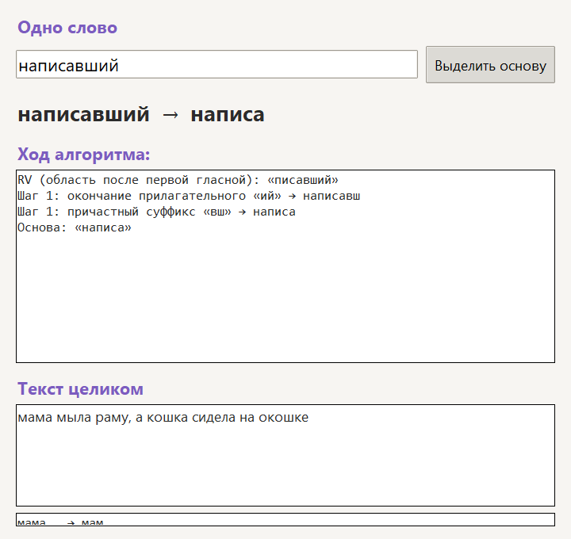

# ✂️ Porter Stemmer — выделение основы слова алгоритмом Портера

Десктопное приложение на **Python (tkinter)**, реализующее классический **алгоритм Портера** для русского языка. Программа выделяет основу слова и наглядно показывает каждый шаг алгоритма — какие суффиксы и окончания отсекались.



## ✨ Возможности

- Выделение основы **одного слова** с пошаговым протоколом работы алгоритма
- Пакетная обработка **текста целиком** — основа вычисляется для каждого слова
- Показ области **RV** (часть слова после первой гласной), с которой работает алгоритм
- Реализация всех четырёх шагов классического алгоритма:
  1. отсечение деепричастных, возвратных, прилагательных, причастных, глагольных и именных окончаний;
  2. удаление конечной **«и»**;
  3. удаление деривационных суффиксов **-ост-/-ость**;
  4. обработка удвоенной **«нн»**, превосходной степени и мягкого знака
- Корректная обработка буквы **ё** и регистра
- Без внешних зависимостей — только стандартная библиотека Python

## 🛠️ Технологии

- **Python 3.10+**
- **tkinter / ttk** — графический интерфейс
- **re** — регулярные выражения для классов окончаний

## 📋 Требования

- Python 3.10 или выше (tkinter входит в стандартную поставку для Windows и macOS; на Linux может потребоваться пакет `python3-tk`)

## 🚀 Запуск

Клонируйте репозиторий:

```bash
git clone https://github.com/ваш-username/porter-stemmer.git
cd porter-stemmer
```

Запустите приложение:

```bash
python app.py
```

## 🎯 Использование

1. Введите слово в поле «Одно слово» и нажмите **«Выделить основу»** (или Enter).
2. В блоке «Ход алгоритма» появится протокол: область RV и каждое отсечённое окончание.
3. Для пакетной обработки вставьте текст в поле «Текст целиком» и нажмите **«Обработать текст»**.

### Пример

```
написавший  →  напис

RV (область после первой гласной): «писавший»
Шаг 1: прилагательное окончание «ий» → написавш
Шаг 1: причастный суффикс «авш» → напис
Основа: «напис»
```

## 🔬 Как это работает

Алгоритм Портера не использует словарь: он последовательно отсекает от слова типичные русские окончания и суффиксы. Все правила применяются только к области **RV** — части слова после первой гласной, что защищает короткие корни от разрушения.

- **Шаг 1.** Ищется совершенный деепричастный суффикс (`-в`, `-вши`, `-вшись`, `-ив`, `-ыв`, …). Если не найден, последовательно пробуются: возвратный суффикс (`-ся`/`-сь`), окончания прилагательных и причастий, глагольные окончания, окончания существительных.
- **Шаг 2.** Если слово оканчивается на **«и»**, она удаляется.
- **Шаг 3.** Если деривационный суффикс `-ост-`/`-ость` находится в области **R2** (RV внутри RV), он удаляется.
- **Шаг 4.** Убирается одна из удвоенных **«нн»**, суффикс превосходной степени (`-ейш-`/`-ейше-`) и конечный мягкий знак.

Основа не обязана быть словарным словом — стеммер лишь приводит разные словоформы к общему виду (`машины`, `машине`, `машиной` → `машин`).

## 📁 Структура проекта

```
porter-stemmer/
├── app.py            # Окно приложения: ввод, результат, протокол шагов
├── stemmer.py        # Алгоритм Портера для русского языка
├── docs/
│   └── screenshot.png
└── README.md
```
